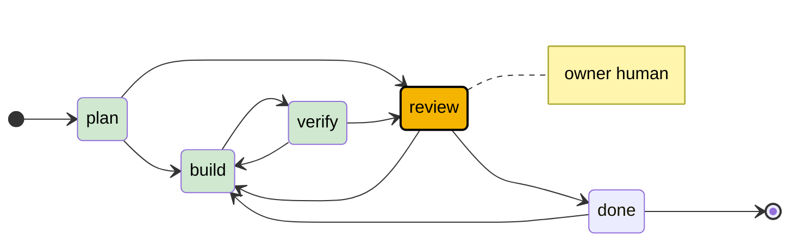

# Architecture skeleton and mechanical constraints

## Goal
Constrain other agents so results are verifiable and consistent: lock the code's shape in a skeleton, enforce it with checks, and make tests deterministic

## Plan
Write the skeleton the issues fill: module boundaries, types and signatures with notImplemented bodies, ports for time and ids. Enforce with lint and a chart-vs-table script. Add the harnesses for pair-table, contract and seeded model-based tests. Stacked on PR #1 as PR #2.

## Tasks
- [x] record D17-D20 (owner 2026-11-16) in ARCHITECTURE.md
- [x] skeleton: types, signatures, notImplemented bodies
- [x] ports: Clock and Ids injected; determinism lint ban
- [x] lint boundaries: feature internals, pg, fetch, storage
- [x] transition tables + check-state-machines script with negative control
- [x] machine pair-table test helper + model-test harness
- [x] contract-test helper (responses parsed by shared schemas)
- [x] AGENTS.md and issues point at the skeleton
- [x] lockfile + CI green on both platforms

## Handoff
From: claude
To: human
For: review
Next: Merge PR #1, then the skeleton PR; then an agent can take any ready:antigravity issue

## Walkthrough
What changed for the next agent: skeleton for api, todos and testing with notImplemented('#issue') bodies; both transition tables; lint boundaries; issues #2-#5 carry a "Skeleton" section.

Evidence (CI run 43847766451, PR #9, Ubuntu and Windows): lint rules "10 cases behave as D14 says"; "state machines: 2 charts match their tables"; Jest 8/8 (validateTitle 5, checkMachine 3 with two negative controls).
Found and fixed: the components lint block dropped the AsyncStorage ban (block override); a case now checks it. RESTORED went to two states in the chart; split into RESTORED and NOTHING_STORED.

## State
<!-- chart:start (generated by state.py, do not edit) -->

<!-- chart:end -->
