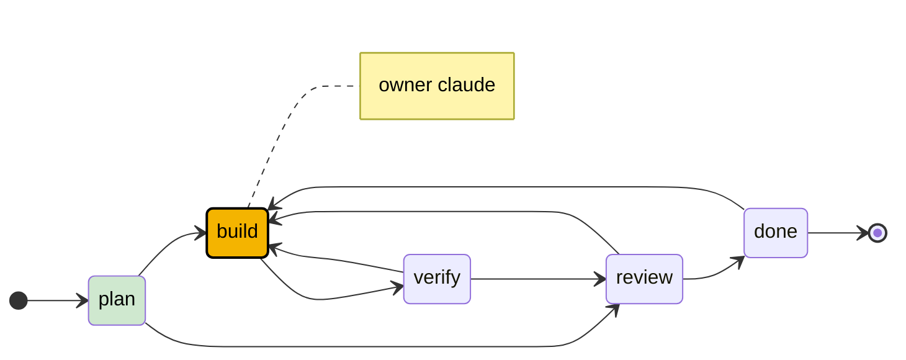

# Architecture skeleton and mechanical constraints

## Goal
Constrain other agents so results are verifiable and consistent: lock the code's shape in a skeleton, enforce it with checks, and make tests deterministic

## Plan
Write the skeleton the issues fill: module boundaries, types and signatures with notImplemented bodies, ports for time and ids. Enforce with lint and a chart-vs-table script. Add the harnesses for pair-table, contract and seeded model-based tests. Stacked on PR #1 as PR #2.

## Tasks
- [ ] record D17-D20 (owner 2026-11-16) in ARCHITECTURE.md
- [ ] skeleton: types, signatures, notImplemented bodies
- [ ] ports: Clock and Ids injected; determinism lint ban
- [ ] lint boundaries: feature internals, pg, fetch, storage
- [ ] transition tables + check-state-machines script with negative control
- [ ] machine pair-table test helper + model-test harness
- [ ] contract-test helper (responses parsed by shared schemas)
- [ ] AGENTS.md and issues point at the skeleton
- [ ] lockfile + CI green on both platforms

## Handoff

## Walkthrough

## State
<!-- chart:start (generated by state.py, do not edit) -->

<!-- chart:end -->
