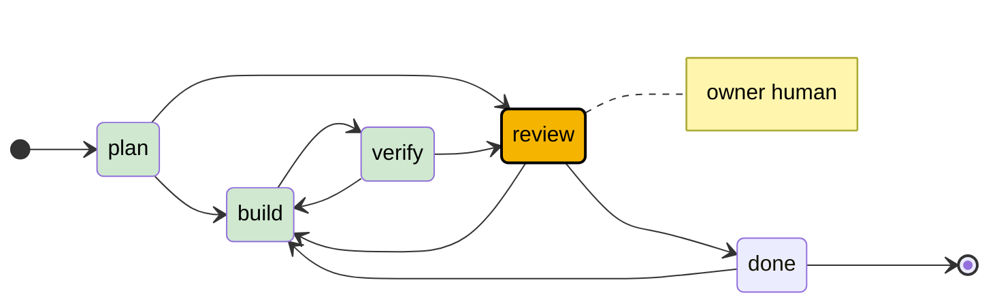

# Infra, CI and agent workflow for the Expo todo app

## Goal
Set up infra and CI/CD like awan-lang and Awanfs, map the app design (API client, state, errors), and leave docs, issues and AGENTS.md so another AI can continue

## Plan
Copy Awanfs's shape (GitHub-hosted ubuntu+windows matrix, docker image on v* tags, lockfile workflow, Definition-of-Ready issues, iskandar-mode agent rules), cut to what an assessment app needs. No formal verification (owner 2026-11-16). Scaffold is minimal; features are issues.

## Tasks
- [x] agent rules: AGENTS.md, CLAUDE.md, .claude/settings.json, issue-writing skill
- [x] design docs: ARCHITECTURE, API contract and quirks, statecharts
- [x] scaffold: Expo TS app with reducer sketch and one test
- [x] CI: ci.yml (ubuntu+windows), lockfile.yml
- [x] labels, issue templates, PR template
- [x] file Definition-of-Ready issues
- [x] owner OK to push; push; dispatch lockfile + CI; record run evidence

## Handoff
From: claude
To: human
For: review
Next: Review and merge PR #1; then set branch protection on main; schedule the design session
Open questions: Enable branch protection on main requiring the CI checks?

## Walkthrough
What a user of this work gets: an Expo SDK 58 app skeleton with Ubuntu + Windows CI (expo lint, tsc, doc checks, Jest, Android bundle) and docs that state the contract (API quirks, one reducer, decisions), plus a ready queue.

Evidence
- Lockfile run 43841442652 failed (ERESOLVE, @testing-library/react-native peer react-test-renderer vs React 19.3.0); fixed in 8c29cb4; rerun 43841681873 success.
- CI run 43842162644 failed in tsc (TS 6 no longer auto-includes @types/jest); fixed by compilerOptions.types; rerun 43842458810 success on Ubuntu and Windows: Jest 5/5, expo lint, tsc, "Android Bundled ... (594 modules)".
- check-docs and check-skill-mirror pass.
- Issues #2-#8 filed with milestones; #2, #3, #4 ready:antigravity; #5 blocked; #6 design session needs the owner.

Not done: branch protection on main (owner setting); M2 design session (#6).

## State
<!-- chart:start (generated by state.py, do not edit) -->

<!-- chart:end -->
