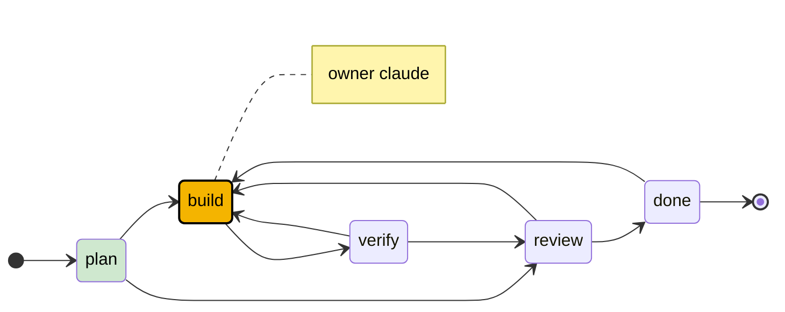

# Infra, CI and agent workflow for the Expo todo app

## Goal
Set up infra and CI/CD like awan-lang and Awanfs, map the app design (API client, state, errors), and leave docs, issues and AGENTS.md so another AI can continue

## Plan
Copy Awanfs's shape (GitHub-hosted ubuntu+windows matrix, docker image on v* tags, lockfile workflow, Definition-of-Ready issues, iskandar-mode agent rules), cut to what an assessment app needs. No formal verification (owner 2026-11-16). Scaffold is minimal; features are issues.

## Tasks
- [x] agent rules: AGENTS.md, CLAUDE.md, .claude/settings.json, issue-writing skill
- [x] design docs: ARCHITECTURE, API contract and quirks, statecharts
- [x] scaffold: Expo TS app with reducer sketch and one test
- [x] CI: ci.yml (ubuntu+windows), lockfile.yml
- [ ] labels, issue templates, PR template
- [ ] file Definition-of-Ready issues
- [ ] owner OK to push; push; dispatch lockfile + CI; record run evidence

## Handoff

## Walkthrough

## State
<!-- chart:start (generated by state.py, do not edit) -->

<!-- chart:end -->
