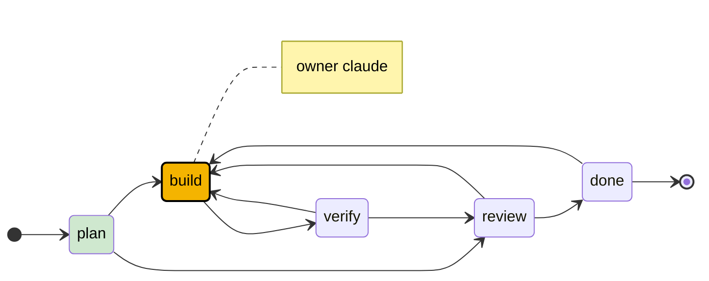

# Guidance and a CI guard for changing states and tests without weakening them

## Goal
Agents can add or change states, behaviour and tests as the UI evolves, with a written procedure and a CI check that stops weakened tests unless the owner approves

## Plan
A skill names the four kinds of change (new behaviour, refactor, decided change, wrong test) and the chain of edits for a new, renamed or removed state. scripts/check-test-diff.mjs reads the PR's diff and flags removed assertions, new skips, loosened matchers, lower property-test runs and raised step budgets; the test-guard workflow fails on any of them unless the owner labels the PR test-change-approved.

## Tasks
- [x] restore skeleton and UX loop on main (stacked PRs merged into their bases)
- [x] changing-behaviour skill: kinds of change, what counts as weakening, adding/renaming/removing a state
- [x] check-test-diff.mjs: removed assertions, skips, loosened matchers, raised budgets
- [x] test-guard workflow + label test-change-approved
- [x] AGENTS.md, issue-writing gate line
- [ ] negative controls on the script; CI green

## Handoff

## Walkthrough

## State
<!-- chart:start (generated by state.py, do not edit) -->

<!-- chart:end -->
