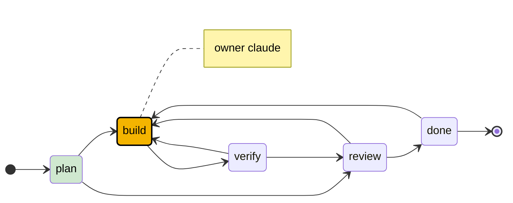

# UI snapshots, UX flows with step budgets, bug and UX feedback loop

## Goal
Owner sees UI snapshots in PRs and issues, files bugs and UX feedback with screenshots, navigates and edits UX flows with step budgets, and reviews and comments on issues

## Plan
docs/UX_FLOWS.md is the owner-editable source (screens, flows, budgets, map). e2e/screens.ts captures each built state; flow specs count steps against the doc's budget and save a filmstrip. ui-snapshots.yml pushes PNGs to the ui-snapshots branch and upserts one PR comment (before/after); dispatch posts screens on any issue. Bug and UX feedback forms; ui-evidence skill for agents; check-ux.mjs keeps doc and code in step.

## Tasks
- [ ] UX_FLOWS.md: step rule, screens, flows with budgets, map, how the owner takes part
- [ ] e2e: screens catalog, snapshots spec, flow helper counting steps
- [ ] check-ux.mjs with negative controls
- [ ] ui-snapshots.yml: capture, publish to ui-snapshots branch, upsert PR comment, dispatch to an issue
- [ ] issue forms: bug, UX feedback; labels; PR template UI section
- [ ] ui-evidence skill for agents; AGENTS.md review rule
- [ ] todo: react-native-web render, static server, stubbed API, e2e job
- [ ] CI green; snapshot comment posted on the PR

## Handoff

## Walkthrough

## State
<!-- chart:start (generated by state.py, do not edit) -->

<!-- chart:end -->
