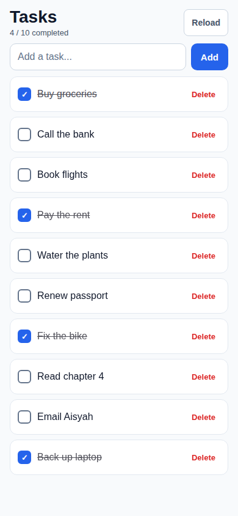
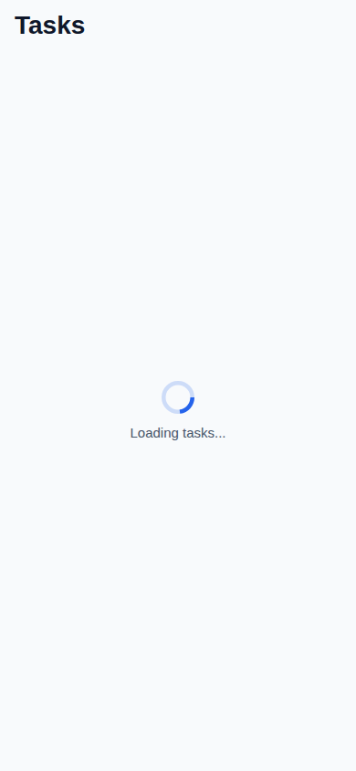
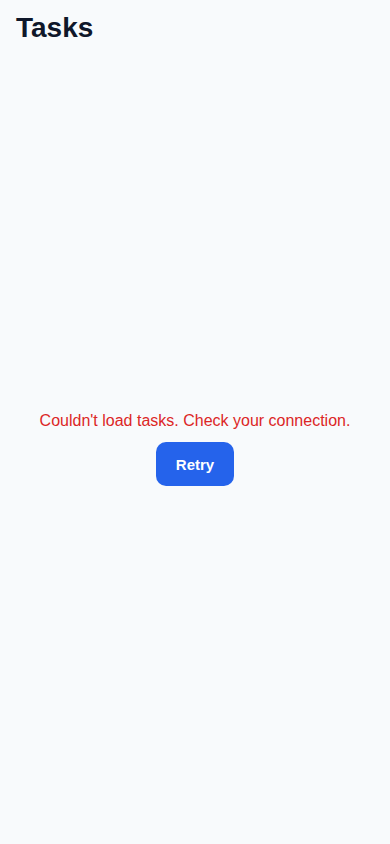
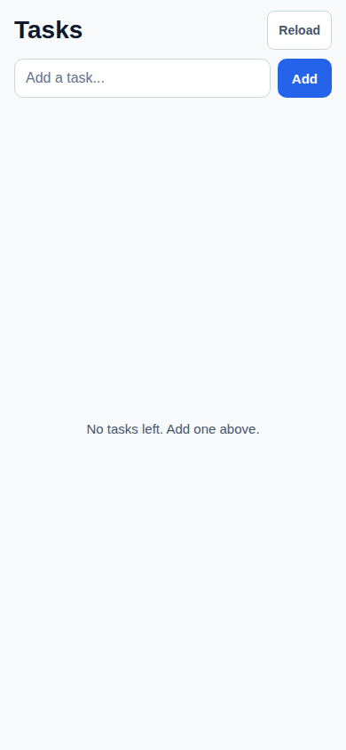
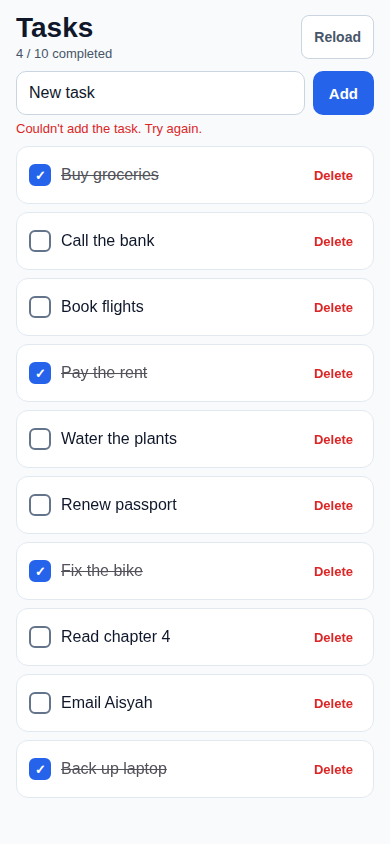

# Todo

A single-screen React Native (Expo) to-do list backed by the JSONPlaceholder API, with local persistence in AsyncStorage. Built around one pure state-machine reducer (`todosReducer`) so loading, error, empty, and saving states stay explicit and testable.

## Screenshots

Web renders at phone width (`390 x 844`):

| List | Loading | Error | Empty | Add error |
|---|---|---|---|---|
|  |  |  |  |  |

## Run it

Prerequisites: **Node 22** (see `.nvmrc`) and the **Expo Go** app on your phone (if running on a device).

```sh
npm ci
npx expo start
```

- **Phone (Expo Go):** Scan the QR code shown by `npx expo start`.
- **Web:** Press `w` in the Expo CLI, or run `npx expo start --web`.

## Test it

```sh
npm test
npm run e2e
```

First-time Playwright setup for `npm run e2e`:

```sh
npx playwright install chromium
```

To run all checks (lint, module boundary rules, TypeScript, doc/state-machine checks, Jest, and Android JS bundle):

```sh
npm run ci
```

## How it works

**One reducer.** Screen state is a discriminated union (`hydrating`, `loading`, `failed`, `ready`) driven by a pure function in [todosReducer.ts](src/todos/todosReducer.ts). `useTodos` runs side effects (storage, `fetchTodos`, `createTodo`) and dispatches events, while components in `src/components/` render props and call callbacks.

**Local ids.** Every task carries a `localId` (`server-<id>` for fetched tasks, `local-<counter>` for added ones) used for React keys, toggling, and deleting. Stored lists are validated on restore so duplicate `localId`s are rejected and `nextLocalId` is always above any `local-N`.

**Storage wins on launch.** Tasks and `nextLocalId` are saved to AsyncStorage (`todo/tasks/v1`) after every change. On launch, the app restores the stored list without fetching; it fetches from the server only when storage is empty or when the user taps **Reload** and confirms.

**The 10 s timeout.** [todosApi.ts](src/api/todosApi.ts) is the only module that calls `fetch`. Every request races against a 10 s `AbortController` timer covering both headers and JSON body parsing, checks `response.ok`, validates the JSON shape by hand, and maps failures to `ApiError` (`network`, `timeout`, `http`, `shape`).

## API quirks

- **`POST /todos` always returns `id: 201`.** Adding two tasks produces two responses with `id: 201`, which is why the app keys and mutates tasks by `localId` instead of server `id`.
- **Writes are simulated.** JSONPlaceholder accepts `POST /todos` without persisting it, and toggles/deletes are local only. Tapping **Reload** (and confirming) replaces the local list with the original 10 tasks from `GET /todos?_limit=10`.

## Project layout

| Path | What |
|---|---|
| `App.tsx` | Root provider and safe-area wrapper |
| `src/screens/TodosScreen.tsx` | Screen wiring `useTodos()` to components |
| `src/components/` | Presentational components (`TodoList`, `TodoItem`, `AddTodoForm`, `LoadingState`, `ErrorState`, `EmptyState`, `ReloadConfirm`) |
| `src/todos/` | `types.ts`, `todosReducer.ts`, `useTodos.ts`, `storage.ts`, `validateTitle.ts` |
| `src/api/` | `todosApi.ts` (the only `fetch`), `messages.ts`, `types.ts` |
| `src/theme.ts` | WCAG AA color tokens and tablet `maxContentWidth` |
| `e2e/` | Playwright screen captures (`screens.ts`) and step-budgeted flows (`flows/F1`–`F6`) |
| `docs/` | [REQUIREMENTS.md](docs/REQUIREMENTS.md), [ARCHITECTURE.md](docs/ARCHITECTURE.md), [API.md](docs/API.md), [STATE_MACHINES.md](docs/STATE_MACHINES.md), [UX_FLOWS.md](docs/UX_FLOWS.md) |
