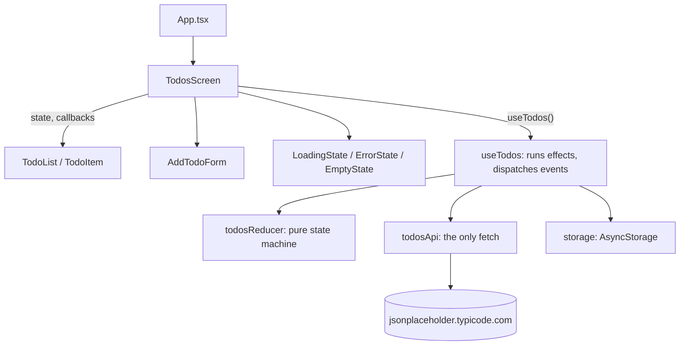

# Architecture and decisions

Each decision has an id. Status is `decided (who, date)`, `proposed` (Claude's recommendation,
holds until the owner says otherwise) or `open` (an issue labelled `needs-decision` waits for
it). A test never reverses a decision; a changed decision is edited here first.

## The shape

## Decisions

| Id | Decision | Status |
|---|---|---|
| D1 | Expo (managed, runs in Expo Go), TypeScript, functional components and hooks, `fetch`. No navigation library: the app is one screen. | decided (owner, 2026-11-16) |
| D2 | Screen state is one `useReducer` over a union of states (`docs/STATE_MACHINES.md`), run by a `useTodos` hook. No Redux, Zustand or TanStack Query. | decided (owner, 2026-11-16) |
| D3 | Every task gets a `localId` on arrival (`server-<id>` for fetched tasks, `local-<counter>` for added ones). Keys, toggle and delete use `localId`; the server `id` is kept only for display and debugging. | proposed |
| D4 | `todosApi` sets a 10 s timeout with `AbortController`, treats any non-2xx as an error, checks the JSON shape by hand (a 15-line guard, no zod), and turns every failure into `ApiError { kind: 'network' \| 'timeout' \| 'http' \| 'shape', status? }`. | proposed |
| D5 | AsyncStorage keeps the task list (key `todo/tasks/v1`, with `nextLocalId`). On launch the stored list wins; the API is fetched only when nothing is stored, or by a Reload action after a confirm. Saved after every change. | decided (owner, 2026-11-16) |
| D6 | Titles are trimmed and must be 1 to 200 characters after trimming (`validateTitle`). The trimmed title is what is sent. | proposed |
| D7 | Added tasks go to the top of the list, so the user sees the result of the action. | proposed |
| D8 | Tests: Jest with `jest-expo`, React Native Testing Library for components, `global.fetch` stubbed per test. No test calls the real API. | proposed |
| D9 | CI on Ubuntu and Windows: lint (`expo lint`), typecheck, doc checks, tests, and `expo export --platform android` (bundles the JS, catches import and Metro errors without an emulator). No formal verification. | decided (owner, 2026-11-16) |
| D10 | Dependency versions follow the Expo SDK (`npx expo install`). `package-lock.json` is committed; a session without network uses the `lockfile` workflow. | proposed |

Dependencies D1 to D10 allow: `expo`, `react`, `react-native`, `expo-status-bar`,
`@react-native-async-storage/async-storage`, `react-native-safe-area-context`, and for
development `typescript`, `@types/react`, `jest`, `jest-expo`,
`@testing-library/react-native` (with `react-test-renderer` at exactly the installed `react`
version, which it needs as a peer), `eslint`, `eslint-config-expo`. Anything else stops with
`needs-decision`.

## Why, and what else was considered

**D2, one reducer.** The brief grades "clear loading and error states". A union of states
makes the impossible ones (loading and error at once, a list behind an error) unrepresentable,
and a pure reducer is tested without rendering. Considered: separate `useState` flags (they
drift: `loading=false, error=null, items=[]` means both "empty" and "not started"); TanStack
Query (less code, but it hides the API handling the assessors want to read); Zustand (a global
store for one screen).

**D3, local ids.** JSONPlaceholder answers every `POST /todos` with `id: 201`, so a second
added task would share a key with the first; React then drops or mixes rows, and deleting one
deletes both. Considered: `Date.now()` ids (collide on fast double taps); `crypto.randomUUID`
(not available in every Hermes version without a polyfill).

**D5, persistence (decided: A).**

| Option | On launch | "Reload" action | For | Against |
|---|---|---|---|---|
| A. Stored list wins (chosen) | Show the stored list if there is one; fetch only when nothing is stored | Replaces the list with a fresh fetch, after a confirm | Simple; "remain after restarting" holds exactly | The first fetch happens once per install |
| B. Fetch, then replay local changes | Always fetch, then re-apply stored toggles, deletes and adds | Not needed | The list stays in touch with the API | Fetched data never changes (writes are simulated), so the merge code buys nothing; added tasks share `id: 201`, so matching is by local id only |

In both, the reducer is unchanged: storage only feeds `RESTORED(items)` and saves on change.

**D4, hand-written guard.** One response shape (`{ userId, id, title, completed }`) does not
earn a schema library.

## Out of scope

Editing titles, reordering, filtering, multiple screens, authentication, a backend.
