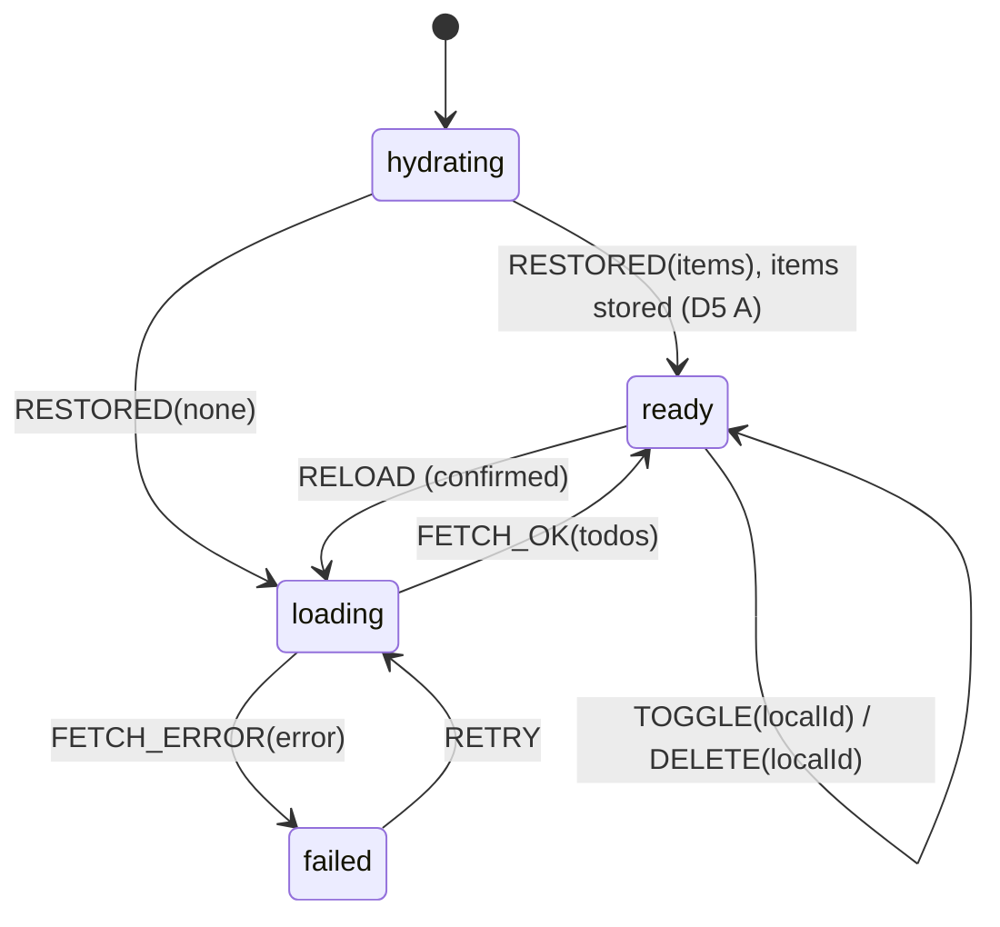
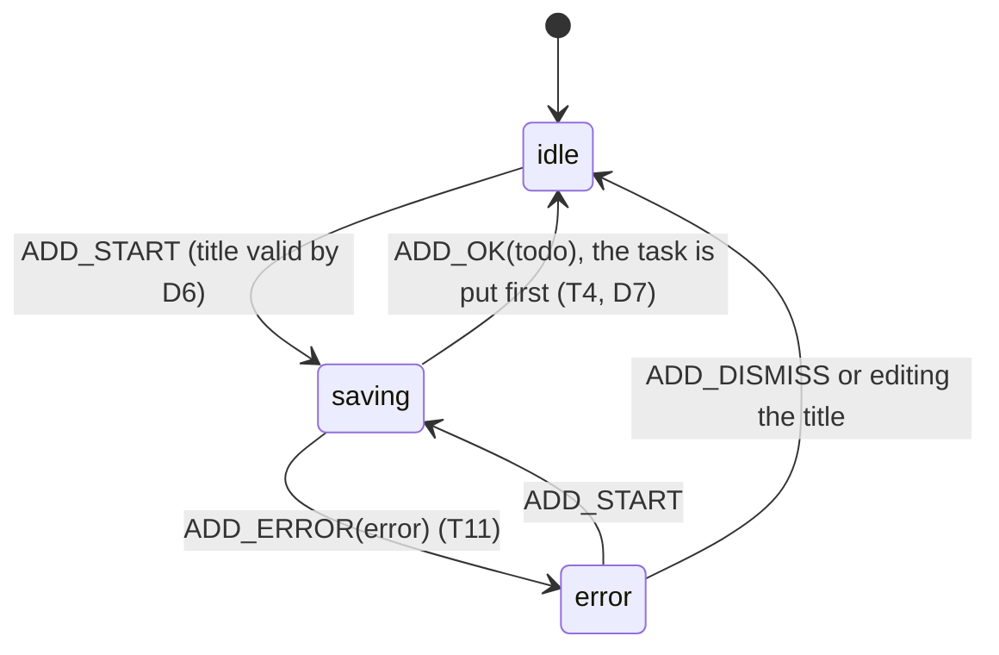

# State machines

The screen is one pure reducer, `src/todos/todosReducer.ts`, over the states below.
`src/todos/todosReducer.test.ts` covers every (state, event) pair: drawn pairs move to the
drawn state, every other pair leaves the state unchanged (returns the same object). A change to
this chart goes in the same commit as the reducer and its test. The reducer does not exist
yet; the issue that builds it links here.

## Screen



```ts
type Task = { localId: string; serverId: number; title: string; completed: boolean };
type AddStatus = { kind: 'idle' } | { kind: 'saving' } | { kind: 'error'; error: ApiError };
type ScreenState =
  | { kind: 'hydrating' }
  | { kind: 'loading' }
  | { kind: 'failed'; error: ApiError }
  | { kind: 'ready'; tasks: Task[]; add: AddStatus; nextLocalId: number };
```

"Empty" is not a state: it is `ready` with `tasks.length === 0`, and the screen shows the
empty state (T8) with the add form still available.

## Adding a task, inside `ready`



- In `saving`, `ADD_START` changes nothing (T10: no double submit); the button is disabled.
- `ADD_START` with an invalid title is never sent: the form shows the validation message and dispatches nothing (T9).
- `TOGGLE` and `DELETE` work while a task is `saving`.
- When the list was replaced while a POST was in flight (`RELOAD`), the late `ADD_OK` still adds the task; there is no cancel.
