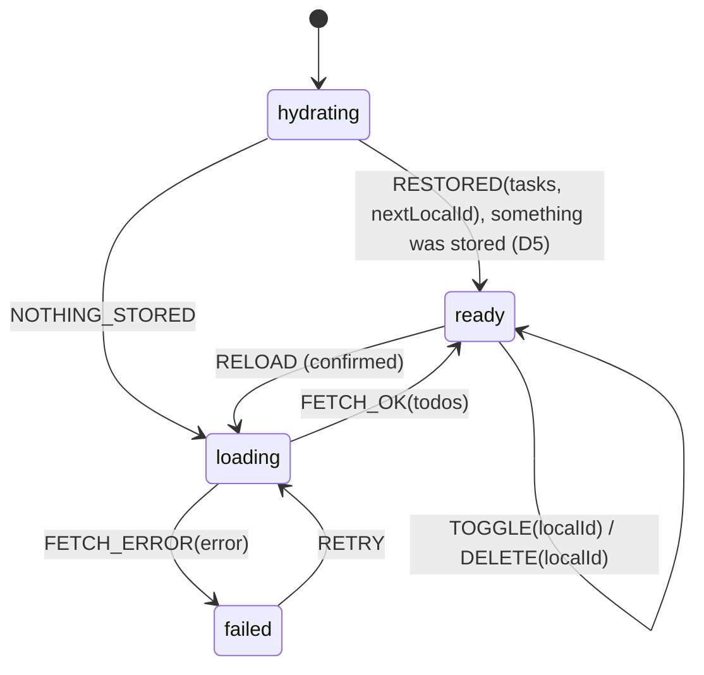
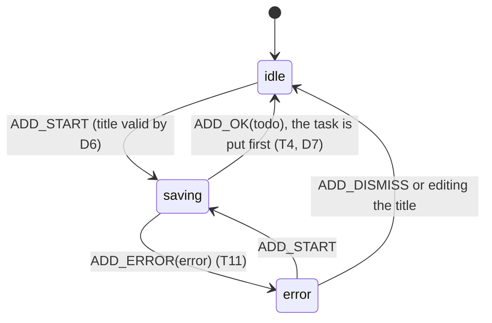

# State machines

The screen is one pure reducer, `src/todos/todosReducer.ts`, over the states below (D2, D13).
Each heading names the file and the transition table exported from it. Two checks keep them in
step:

- `node scripts/check-state-machines.mjs` (in `npm run ci`) fails when a chart's arrows and its
  table differ, or when a `*_TRANSITIONS` table has no chart here.
- `checkMachine` (`src/testing/checkMachine.ts`), called from `src/todos/todosReducer.test.ts`,
  runs every sample state against every sample event: drawn pairs end in the drawn state, every
  other pair returns the same object, and every state, event and row needs a sample. Run it
  twice: once with the screen events, once with the add events (`kindOf` reads `state.add.kind`
  when the screen is `ready`, and `outside` otherwise).

The types and tables exist (`src/todos/types.ts`, `src/todos/todosReducer.ts`); the reducer
body is issue #3. A change to a chart goes in the same commit as its table, reducer and test.

## Screen (`src/todos/todosReducer.ts`, `SCREEN_TRANSITIONS`)

The state and event types are in `src/todos/types.ts` (one source; this file does not copy them).

"Empty" is not a state: it is `ready` with `tasks.length === 0`, and the screen shows the
empty state (T8) with the add form still available.

## Adding a task, inside `ready` (`src/todos/todosReducer.ts`, `ADD_TRANSITIONS`)

- In `saving`, `ADD_START` changes nothing (T10: no double submit); the button is disabled.
- `ADD_START` with an invalid title is never sent: the form shows the validation message and dispatches nothing (T9).
- `TOGGLE` and `DELETE` work while a task is `saving`.
- Add events while the screen is not `ready` change nothing. A POST still in flight when the user reloads is dropped when it answers: the reload replaces the list anyway (D5).
