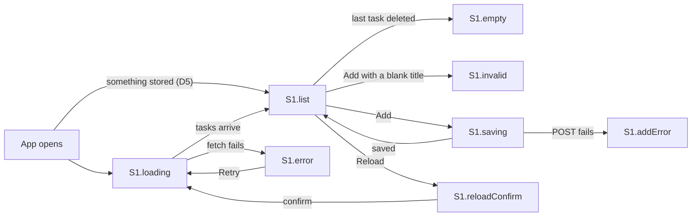

# UX flows and screens

The owner's map of the app: every screen state that gets a screenshot, every user task (flow)
with the most steps it may take, and how they connect. **This file is the source.** The e2e
flow specs read their step budgets from the Flows table, and `node scripts/check-ux.mjs` (in
`npm run ci`) fails when this file and the code disagree.

Screenshots in CI are the **react-native-web render** at phone and tablet width (D15). They
show layout, text and states; native details (fonts, shadows, the keyboard) need Expo Go, so a
UI PR also attaches screenshots from a phone.

## How the owner takes part

| To | Do this |
|---|---|
| See every state as it is on `main` | Open the [`ui-snapshots` branch, `main/latest/`](https://github.com/iskandarnorazli/todo/tree/ui-snapshots/main/latest) |
| See what a PR changes | Read the PR's "UI snapshots" comment (main beside the PR, a filmstrip per flow) and the phone screenshots in the PR body. Comment on it. |
| See a state on any issue, now | Actions, "UI snapshots", Run workflow: the issue number and the state or flow ids (empty means all). |
| Try it on your phone | `npx expo start` on the PR's branch, scan the QR code with Expo Go. |
| Report a bug | New issue, "Bug": where (an id below), steps, expected, actual, a screenshot. |
| Propose a UX change | New issue, "UX feedback", or edit the tables below in a PR. A budget you lower fails the flow's spec until the UI meets it. |
| Ask for a review | Agents label UI PRs `needs-owner-review`; your comment on the snapshot comment is the review. |

## What counts as a step

One deliberate user action: a tap, filling one field (typing a whole value counts once),
pressing a key such as Enter or Done, answering a confirm dialog. Waiting, reading, scrolling
and pull-to-refresh animations are not steps. A flow spec wraps each action in
`step(label, action)` and saves a screenshot after it.

## Map

The app is one screen (S1); the map is its states, which follow `docs/STATE_MACHINES.md`.

## Screens

Each row is one state captured at phone (390 x 844) and tablet (820 x 1180) width. `planned`
rows are captured once the screen exists; the issue that builds it changes its rows to `built`
and adds the setup (with the stubbed API) in `e2e/screens.ts`.

| State | Screen | What it shows | Status |
|---|---|---|---|
| S1.loading | Tasks | The loading indicator while the first fetch runs (T6) | built |
| S1.list | Tasks | Ten tasks, some completed (T1) | built |
| S1.error | Tasks | "Couldn't load tasks." with Retry (T7) | built |
| S1.empty | Tasks | The empty state after the last task is deleted (T8) | built |
| S1.invalid | Tasks | The form's message after Add with a blank title (T9) | built |
| S1.saving | Tasks | The Add button disabled while the POST runs (T10) | built |
| S1.addError | Tasks | "Couldn't add the task." under the form (T11) | built |
| S1.reloadConfirm | Tasks | The confirm before replacing the list with a fresh fetch (D5) | planned |

## Flows

`Budget` is the most steps the flow may take. `enforced` means `e2e/flows/<Flow>.spec.ts`
exists and fails CI over budget; `planned` means its screen is not built yet.

| Flow | Task | Starts on | Budget | Status | Requirements |
|---|---|---|---|---|---|
| F1 | See the first ten tasks | App start, nothing stored | 0 | enforced | T1, T6 |
| F2 | Add a task | S1.list | 2 | enforced | T3, T4 |
| F3 | Mark a task done, then not done | S1.list | 2 | enforced | T2 |
| F4 | Delete a task | S1.list | 1 | enforced | T5 |
| F5 | Recover from a failed load | S1.error | 1 | enforced | T7 |
| F6 | Reload the list from the server | S1.list | 2 | planned | D5 |

Why these budgets: F2 is the title and Add (or Enter). F4 is one tap; a delete confirm would
make it 2, a design-session question (#6). F6 is Reload and its confirm.
